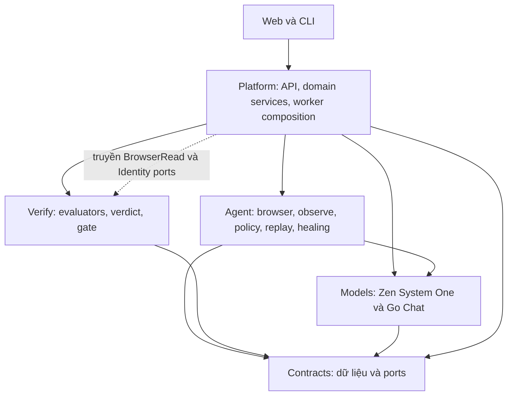
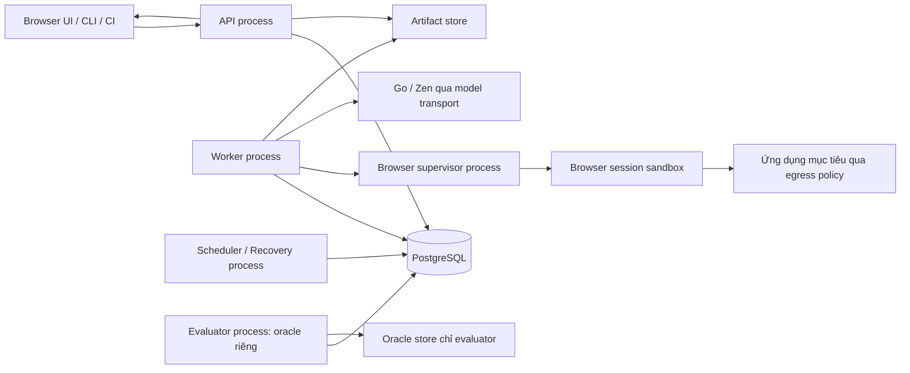
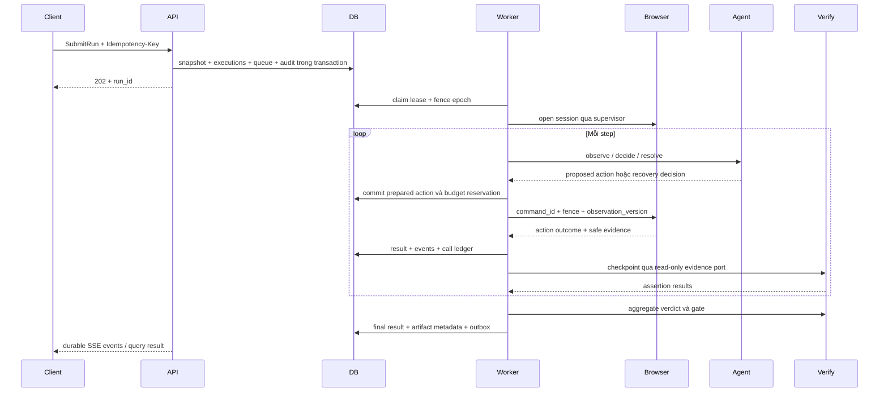

# AgentQA — thiết kế hệ thống

- Ngày: 2026-10-06
- Phiên bản thiết kế: 1.0
- Trạng thái: Thiết kế đề xuất dựa trên spec đã được chọn làm cơ sở; chưa triển khai
- Phạm vi: Toàn hệ thống, năm lớp, local/shared và RQ1–RQ3
- Yêu cầu: [Product spec](specs/product-spec.md)

## 1. Quyết định kiến trúc

Chọn backend theo kiến trúc modular monolith, tách các tiến trình API, worker, supervisor phiên trình duyệt và scheduler. Các module dùng cùng Contracts và database, nhưng browser/mô hình không chạy trong request HTTP. Frontend React/TypeScript sử dụng API và event stream; CLI là client của cùng API. PostgreSQL là nguồn sự thật cho revision, quyền, run, queue và ledger. Blob lớn lưu trong artifact store riêng.

Mục tiêu là nhất quán nghiệp vụ, kết luận kiểm thử có bằng chứng và khả năng mở rộng worker độc lập. Tách tiến trình để cô lập crash, browser và tài nguyên; tách module để kiểm tra phụ thuộc và thay thế thành phần.

| Phương án đã xét | Ưu điểm | Đánh đổi | Kết luận |
|---|---|---|---|
| Backend chia module + worker riêng + durable database queue | Revision/run/event chốt bằng transaction; frontend và CLI dùng một quy tắc; worker mở rộng riêng | Phải thiết kế leases, journal, recovery và admission rõ | Chọn |
| Microservices cho từng lớp | Deploy độc lập từng dịch vụ | Giao dịch phân tán trên promote/snapshot/gate, nhiều schema và failure boundaries | Không chọn cho topology hiện tại; module boundary vẫn cho phép tách dịch vụ khi có yêu cầu |
| Workflow engine ngoài + activities | Cung cấp điều phối dài hạn và lịch sử workflow | Browser side effects vẫn không có exactly-once; có thêm runtime/state model phải đồng bộ | Không thêm workflow engine trong kiến trúc này |

Không hứa exactly-once cho thao tác trên website bên ngoài. Database transaction và fencing bảo vệ lệnh/kết quả nội bộ; các thao tác in-flight có kết quả không rõ được giữ unknown và không tự lặp. Đây là invariant, không phải thiếu sót được che bằng retry.

## 2. Bộ tài liệu chi tiết

| Tài liệu | Nguồn sự thật của phần thiết kế |
|---|---|
| [contracts-and-dsl.md](design/contracts-and-dsl.md) | Models, ports, Case DSL, version/digest và validation |
| [execution-and-models.md](design/execution-and-models.md) | Browser, quan sát, policy, hai adapter provider và thực thi |
| [verification-and-healing.md](design/verification-and-healing.md) | Target identity, guard/healing, assertion, verdict và gate |
| [platform-and-storage.md](design/platform-and-storage.md) | Database, queue/fencing, artifacts, lịch chạy, phục hồi và backup |
| [api-and-security.md](design/api-and-security.md) | REST, events, quyền, secrets, network và tích hợp |
| [web-experience.md](design/web-experience.md) | Navigation, editor/live/compare/experiment, state và accessibility |
| [experiments-and-evaluation.md](design/experiments-and-evaluation.md) | Benchmark, oracle, ma trận, calibration và chỉ số |
| [acceptance-mapping.md](design/acceptance-mapping.md) | Truy vết FR/NFR/AC và kiểm tra thiết kế |

Các tài liệu trên là thiết kế để triển khai. Tên file, interface và database trong tài liệu chưa phải artifact code đã tồn tại.

## 3. Công nghệ được chọn

| Phần | Lựa chọn | Lý do và nguồn |
|---|---|---|
| Runtime backend | Python 3.13, asyncio; uv quản lý môi trường/lock | Tương thích engine async và phân tích dữ liệu; baseline runtime mới, không kế thừa cấu hình cũ. [Python](https://www.python.org/downloads/release/python-3130/) |
| API | FastAPI + Uvicorn | API typed và async, xuất OpenAPI, streaming; browser jobs tách worker. [FastAPI](https://fastapi.tiangolo.com/async/) |
| Contracts | Pydantic v2, JSON Schema 2020-12 | Validation và schema cho Python/TypeScript/DSL. [Pydantic](https://docs.pydantic.dev/latest/concepts/json_schema/) |
| Persistence | PostgreSQL 18; SQLAlchemy 2 async + psycopg 3; Alembic | Transaction, JSONB, row locking, RLS và migrations. [Async ORM](https://docs.sqlalchemy.org/en/20/orm/extensions/asyncio.html), [Alembic](https://alembic.sqlalchemy.org/en/latest/tutorial.html) |
| Browser | Playwright Python async, Chromium baseline | Context, locator, frame/tab và action APIs; engine tự quản lifecycle. [Playwright](https://playwright.dev/python/docs/api/class-page) |
| Provider transport | HTTPX async; hai adapter native HTTP | Giữ wire protocol khác nhau cho Go chat và Zen System One; không cần SDK của provider thứ ba |
| Web | React 19, TypeScript, Vite; Node.js 24 LTS, pnpm | SPA cho editor/live analysis; backend chịu toàn bộ nghiệp vụ. [React](https://react.dev/learn), [Vite](https://vite.dev/guide/), [Node](https://nodejs.org/en/about/previous-releases) |
| Web state/router | TanStack Query + TanStack Router | Tách server state, URL state và editor state. [Query](https://tanstack.com/query/latest/docs/framework/react/overview), [Router](https://tanstack.com/router/latest/docs/overview) |
| UI/schema client | Radix primitives, CSS tokens; openapi-typescript/openapi-fetch và Ajv | Accessible components, API types sinh từ backend, validation schema runtime. [Radix](https://www.radix-ui.com/primitives/docs/overview/accessibility), [OpenAPI types](https://openapi-ts.dev/introduction), [Ajv](https://ajv.js.org/json-schema.html) |
| Editor/charts | Monaco cho YAML; Apache ECharts cho biểu đồ tương tác; HTML/SVG bảng tóm tắt | Chỉnh case có schema diagnostics, drill-down dữ liệu RQ; mọi chart có bảng số tương đương. [Monaco](https://microsoft.github.io/monaco-editor/docs.html), [ECharts](https://echarts.apache.org/handbook/en/get-started/) |
| Documents | pypdf, python-docx, parser YAML safe; extraction subprocess | Trích văn bản có source anchor, cách ly file không tin cậy; không tự OCR file scan. [pypdf](https://pypdf.readthedocs.io/en/stable/user/extract-text.html) |
| Secrets/auth | OS/env secret cho local; cryptography AES-GCM envelope cho credential shared; pwdlib Argon2id cho mật khẩu | Secret không vào models/events/artifacts; khóa mã hoá ngoài database. [AEAD](https://cryptography.io/en/latest/hazmat/primitives/aead/), [pwdlib](https://frankie567.github.io/pwdlib/) |
| Kiểm tra | pytest/pytest-asyncio, ruff, import-linter, TypeScript/Vitest, Playwright UI E2E | Offline fakes, tests có boundary; live conformance riêng |

Các thư viện trên mới được chọn trong thiết kế, chưa cài. Exact versions pin trong lockfiles khi tạo dự án và kiểm tra Windows/Linux; không tự nâng một dependency trong run nghiên cứu. Database 18 và schema version ghi trong deployment/experiment manifests.

## 4. Năm lớp và luật phụ thuộc



Nét đứt mô tả object do Agent implement được Platform truyền vào Verify qua port của Contracts; Agent và Verify không import nhau. Các dependency của mã Python được cưỡng chế:

| Lớp | Import nội bộ được phép | Không được import |
|---|---|---|
| Contracts | Standard library và thư viện validation | Models, Agent, Verify, Platform; Playwright/ORM/HTTP framework |
| Models | Contracts | Agent, Verify, Platform |
| Agent | Contracts, Models | Verify, Platform |
| Verify | Contracts | Agent, Models, Platform |
| Platform | Cả bốn lớp | Không để domain services phụ thuộc vào API routers hoặc UI |

Contracts chứa `Protocol` ports theo nhu cầu bên dùng; chữ ký không lộ `Page`, ORM session, HTTP request hoặc đường dẫn secret. Verify nhận read-only browser evidence và identity resolver đã giới hạn, không có action executor hoặc provider client. Agent không gọi trực tiếp checker; `RunCoordinator` của Platform điều phối checkpoint giữa hai lớp.

Web thuộc boundary giao diện của Platform nhưng chỉ gọi HTTP/events, không đọc database hoặc browser DevTools. CLI cũng không wire engine/checker riêng.

## 5. Topology runtime



API không mở browser. Worker quản lý một execution context, nhưng browser supervisor độc lập giữ journal command và quyền session. Evaluator nghiên cứu có credentials/network namespace riêng; worker không đọc oracle store. Scheduler là tiến trình riêng, được chạy nhiều instance với claim/unique keys trong DB.

Artifact store baseline là filesystem private dùng volume chia sẻ cho các process cùng host. Multi-host dùng artifact gateway cùng storage volume hoặc S3-compatible store, không thay dữ liệu/ACL contract; S3 là storage protocol, không phải thêm model provider. Local profile không cần dịch vụ cloud. Không dùng SQLite/Redis làm nguồn dữ liệu khác cho local; personal/shared dùng cùng semantics PostgreSQL.

## 6. Luồng thực thi và ranh giới bằng chứng



Action đã proposal, đã chuẩn bị, đã accepted, đã tác động và đã xác minh là năm trạng thái riêng. Event `action.proposed` không chứng minh thao tác đã xảy ra. Model calls, finish decision và attempt lỗi đều vào ledger. Redaction nằm trước model input, event persistence và live frames, không chỉ khi export.

## 7. Invariants bắt buộc

1. Ready revision là immutable content; archive là lifecycle metadata riêng, không thay digest.
2. Run snapshot không đọc lại cấu hình mutable để thay kỳ vọng/model/threshold giữa run.
3. Gate không được do policy tự quyết; thiếu assertion/evidence không tạo pass.
4. Một lease epoch chỉ có một command issuer; mất lease chặn lệnh mới, lệnh in-flight được xử lý như outcome cần xác minh.
5. Unknown side effect không tự replay; chỉ outcome chứng minh chưa tác động hoặc fixture reset có receipt mới cho phép chạy lại.
6. Revision/request/event có workspace scope; composite foreign key và authorization không cho reference chéo workspace.
7. Secrets không nằm trong prompt, event, browser artifacts hoặc URL của model-controlled request.
8. Oracle có boundary riêng; không inject ground truth vào DOM/marks/observation/history của policy.
9. Missing cost, provider-free report và subscription allocation là các loại dữ liệu khác nhau.
10. Event/state commit thành một transaction; NOTIFY/SSE không làm nguồn sự thật hoặc đảm bảo exactly-once delivery.

## 8. Cấu trúc mã dự kiến

```text
src/agentqa/
  contracts/      models, case DSL, events, ports, schemas
  models/         opencode_go, opencode_zen, normalization, fakes
  agent/          browser, observation, planning, policies, replay, identity, healing
  verify/         evaluators, evidence, verdict, gate
  platform/       identity, workspaces, authoring, runs, worker, storage, api,
                  scheduler, reports, experiments, evaluation, security, cli
apps/web/         React app, generated API types, editor, live, reports, experiments
benchmarks/       applications, cases, fixtures, variants; oracle material tách access
tests/           unit, contracts, database, engine, browser, API, UI, faults
tools/           schema/client generation, offline validation, manual conformance
infra/           deployment profiles và migrations tooling
```

Đây là cây dự kiến, không tạo thư mục code ở bước thiết kế. CLI entrypoint thuộc Platform; package tên `models` thay `llm` để thể hiện cả hai giao thức. Không đóng băng contracts v1 của phiên bản cũ.

## 9. Deployment, nâng cấp và vận hành

Personal: API bind loopback, frontend cùng origin, owner bootstrap local token, PostgreSQL/volume private, worker/supervisor local. Shared: TLS reverse proxy, auth/session, API/worker roles và encrypted credential broker. Linux chạy browser sandbox/container; Windows chạy supervisor child process bị ràng buộc lifecycle và outbound policy, không giả định Linux namespaces có sẵn.

Ứng dụng versioned, migrations có bước kiểm tra compatibility trước rollout. Deployment không chạy hai version không tương thích trên cùng lease/schema. Worker drain dừng nhận jobs và chờ các action đang diễn ra; run không biết outcome không bị reassignment tự động. Snapshot ghi schema/model/browser/case versions đủ để giải thích khác biệt.

Backup gồm database nhất quán, artifacts manifest/digests và keyring mã hoá theo kênh riêng; workspace export không chứa secret. Restore kiểm tra referential integrity, digest và trạng thái sessions: không hồi sinh run active cùng browser cũ. Chi tiết nằm trong [Platform/storage](design/platform-and-storage.md).

## 10. Kiểm tra thiết kế và bước tiếp theo

Truy vết toàn bộ 51 FR, 12 NFR và 24 AC ở [acceptance mapping](design/acceptance-mapping.md). [Implementation plan](plans/rebuild-plan.md) đã cụ thể hoá thành 32 task/dependencies, gates và [mapping yêu cầu vào task](plans/acceptance-plan.md). Thiết kế/plan chưa có test code hoặc live model result; các đường dẫn/code/commands là đầu ra phải tạo khi thực thi. Không tự commit hoặc gắn remote trong bước viết tài liệu.
