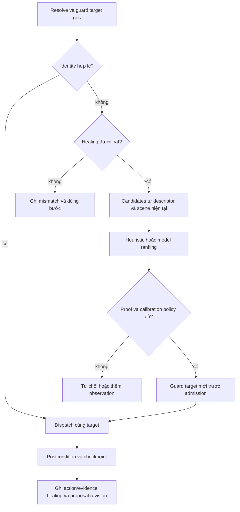

# Identity, phục hồi, kiểm chứng và gate

- Ngày: 2026-10-06
- Trạng thái: Thiết kế đề xuất; thresholds và độ chính xác phải qua calibration/evaluation
- Phạm vi: Agent identity/healer, Verify và Platform result composition
- Liên quan: [Contracts](contracts-and-dsl.md), [engine](execution-and-models.md), [research](experiments-and-evaluation.md)

## 1. Tách các trách nhiệm

Agent resolve target và thực hiện recovery proposal. Verify thực thi assertions trên nguồn bằng chứng read-only, tính verdict/gate thuần. Platform truyền `BrowserReadPort`, identity capability hẹp, clock/evidence sink và execution proofs vào Verify. Verify không import Agent/Models, không có quyền click/fill và không gọi model để đổi verdict.

Model có thể tạo lời giải thích hoặc đề xuất locator/baseline; chúng là proposal records. Comparator, expected value, required/applicability, source và entity scope đã pin không do model sửa trong run.

## 2. Target identity và guard

Descriptor chia hard constraints và soft signals. Hard constraints: context/frame đã cho phép, operation compatibility, entity/business scope, uniqueness và state cần cho action. Soft signals: accessible name tương đương, vị trí/layout, CSS/id/classes, văn bản lân cận và visual fingerprint. Locator là cách tìm candidate, không là danh tính nghiệp vụ.

Guard chạy kể cả khi selector resolve. Nó kiểm tra candidate hiện tại thỏa hard constraints, chỉ có một identity phù hợp và scene version còn hiệu lực. DOM rerender/layout navigation làm proof cũ hết hạn; supervisor check lại trước dispatch. Guard failure ghi loại missing/ambiguous/identity_mismatch; không chuyển thành click first/force để đi tiếp.

Geometry/click proof dùng actual viewport, scroll/DPR, hit target và context. Với target thị giác không có semantic handle, proof dựa image region/mark và postcondition; evidence đánh dấu mức identity chắc chắn, oracle nghiên cứu chấm độc lập. Không hứa model biết chắc mọi identity.

## 3. Candidate ranking

Ranker tạo candidates từ scope đã khai báo, loại operation/state incompatible và secret/untrusted metadata trước scoring. Feature groups: role/type, label/text tương đồng, context/ancestor/entity, stable attribute và geometry/visual. Score mỗi feature được normalize theo version; weighted score và margin top-2 là diagnostic, không là P(correct).

Heuristic baseline dùng cùng features/guards và weights từ calibration, không gọi model. LLM/Jev ranker nhận cùng candidates đã redaction, có none/need_more_context. Missing features giữ missing flag, không chấm bằng zero rồi trình bày đầy đủ. Candidate truncation có manifest và có thể yêu cầu vùng context khác; không thử thao tác để dò đáp án.

Thứ tự quyết định của heuristic: thiếu candidates → thiếu features → margin top-2 dưới ngưỡng (`ambiguous_margin`) → **trùng danh tính (`duplicate_identity`)** → điểm dưới ngưỡng. Quy tắc trùng danh tính: trong các candidates còn lại có điểm đạt ngưỡng và qua kiểm tra role/scope, nếu ≥ 2 candidates khác nhau cùng cặp định danh (role, tên) với ứng viên số một thì từ chối — kể cả khi margin đã qua. Margin chỉ bắt được cặp song sinh giống hệt điểm số; cặp song sinh lệch điểm do attribute/geometry (thường gặp trên browser thật, vd nhãn trùng `duplicate_label`) phải bị chặn bởi quy tắc này thay vì chữa bừa.

## 4. Recovery protocol

Mỗi mismatch opportunity dùng step instance + original target identity + scene scope. Mỗi proposal/attempt có ID riêng, kể cả refused. Recovery before dispatch không gọi đó là action success. HealingRecord lưu ranking, lựa chọn, guards, actual target/evidence, outcome và immutable expectation digest.

Sau recovery, executor chỉ thay target resolution trong runtime binding. Proposal locator mới được thêm vào revision draft với diff/source run. Chấp nhận proposal và promote là thao tác có quyền riêng; không đổi revision đang chạy.

Healer không sửa dữ liệu nghiệp vụ, branch, required assertions, comparator, baseline hoặc expectation. Label mới chỉ được chấp nhận khi identity/context vẫn phù hợp; semantic drift phải từ chối, kể cả confidence cao.

## 5. Evidence-target recovery

Assertion có evidence descriptor riêng. Nếu locator bằng chứng đổi nhưng immutable entity/scope/comparator/expected giữ nguyên, Verify gọi identity capability hẹp để tìm cùng đối tượng. Capability chỉ nhận descriptor và scene, không nhận comparator/expected result để chọn phần tử làm assertion đạt. Entity key từ parameter/capture là identity constraint hợp lệ, khác việc chọn theo kết quả comparison.

Mọi evidence recovery gắn annotation healed và actor=evidence, có scope proof và result record như action recovery. `replay_strict` không dùng recovery này. Nếu không thể giữ identity hoặc bằng chứng độc lập không đủ, result error/not_evaluated và verdict inconclusive nếu chưa có failure hợp lệ.

## 6. Assertion evaluators

| Evaluator | Comparator/chứng cứ | Failure vs error |
|---|---|---|
| Element/text | visible/hidden/absent, exact/contains/regex, count, value, checked/enabled, attributes | Condition false tại checkpoint có preconditions hợp lệ → failed; browser/read error → error |
| URL | scheme/host/path/query được normalize theo rule khai báo | Sai kỳ vọng → failed; không đọc được context → error |
| Entity/relation | Row/form scope, parameter/capture equality, uniqueness và relation constraints | Target scope mơ hồ chưa chấm nghiệp vụ → error; entity không có theo existence expectation đúng checkpoint → failed |
| Network/API | Filter endpoint/method/status/body schema được cho phép; scope thời gian/action | Response khác expected → failed; không đủ response evidence → error hoặc explicit absence failure theo expectation |
| Download | Safe artifact metadata/content hash/type/expected value | File nhận đúng nhưng nội dung sai → failed; không có receipt cần thiết → error hoặc expected absence condition |
| Visual | Baseline revision, viewport, masks, pixel colour/diff ratio profile | Diff vượt tolerance được pin → failed; viewport/baseline/mask không tương thích → error |

Wait policy retry read-only theo điều kiện đến deadline; không sleep rồi coi không thấy là do website sai khi preconditions chưa hoàn thành. Expected absence không bị đổi thành missing evidence; evaluator biết comparator phủ định/existence đã khai báo.

Visual evaluator dùng Pillow/NumPy trên safe image buffers, masked pixel difference và diff ratio có profile/version. Render overlays safe; expected/observed images và dimensions được lưu. Baseline thay đổi là proposal revision; model diagnostic không tự thay baseline/tolerance. Backend không gọi JavaScript `expect.toHaveScreenshot` như API Python có sẵn.

## 7. Applicability và completion

CaseCompiler tạo completion plan cho từng branch/iteration. Runner ghi branch conditions/probe receipts và node outcomes. Verify kiểm tra execution proof khớp plan; không tin danh sách "assertion đã skip" do policy tự đề xuất.

Required assertion chỉ không applicable khi guard branch trong immutable plan chứng minh branch không được chọn. Unvisited required checkpoint chưa có applicability proof là not_evaluated, không skipped. Completion cần các node/postcondition ứng với path thực và ít nhất một applicable required business assertion; empty set không passed.

Postcondition kiểm soát bước có thể là evidence condition thuần, không business assertion. Một thất bại postcondition có expected business meaning và source mới có thể tạo business failure; failure tiến trình/định vị chưa chứng minh lỗi nghiệp vụ thì inconclusive. Compile receipt chỉ rõ loại này.

## 8. Verdict reducer

Reducer nhận immutable expectation plan, execution/completion proofs và AssertionResults. Không nhận model rationale như proof. ExecutionStatus, business verdict, annotations và GateResult là bốn outputs riêng.

| Dữ kiện | Verdict |
|---|---|
| Run active, chưa chốt | null; failed assertion có thể hiển thị tạm nhưng final reducer chốt |
| Có applicable required business assertion false với proof/evidence hợp lệ | failed; giữ failure này dù cleanup/worker lỗi về sau |
| Chưa có failure hợp lệ, nhưng thiếu completion/required proof, verifier error hoặc evidence bắt buộc mất | inconclusive |
| Completion hợp lệ, tất cả applicable required assertions passed, evidence đủ, revision ready | passed |
| Draft/exploration có các điều kiện tương tự | Kết quả provisional kèm verdict tương ứng; không đạt gate chính thức |

Annotation retried/healed/degraded không tự đổi business verdict. Terminal blocked/error/cancelled chốt inconclusive khi không có business failure đã chứng minh; nếu đã chứng minh failure giữ failed. Terminal execution completed vẫn có thể inconclusive do budget hoặc không hoàn tất nghiệp vụ.

## 9. Gate reducer và CLI

`strict`: completed + ready + passed + đủ evidence + không healed/degraded/provisional. `allow_healing` cho phép healed khi có guards/postconditions đầy đủ; không cho degraded hoặc thiếu bằng chứng. Gate trả accepted boolean và reason codes, không thay business verdict.

Suite gate xét tất cả executions đã lập lịch và exclusions khai báo trước. Không chạy một required execution, active timeout, hoặc không có required execution → reject. JUnit ghi gate rejection có diagnostic type; healed strict không bị gọi là business regression.

CLI precedence giữ đúng spec: invalid pre-submit 64; cancelled 130; blocked/error/inconclusive/non-business gate rejection 2; business failed 1; mọi required execution đạt gate 0. Detached submit 0 chỉ xác nhận request, không xác nhận test pass.

## 10. Safe evidence boundary

SafeEvidenceService sanitize semantic/DOM/network buffers, mask screenshots/live frames, strip headers/cookies/query secrets và propagate capture taint trước persist/model/stream. Không đưa raw response body/trace.zip vào artifact store rồi mới redact khi export.

Native Playwright tracing có thể ghi headers/DOM/ảnh nhạy cảm, vì vậy mặc định dùng AgentQA SafeTraceBundle gồm safe snapshots/events/assertions. Native trace chỉ bật cho environment/capture policy chứng minh không chứa sensitive data và qua leak test; không dùng raw native trace làm điều kiện cần để đọc run. Private authenticated storage state là encrypted credential data, không phải trace artifact.

Redaction receipt ghi rule/version, vùng/field loại bỏ và proof data còn dùng được. Mask unrelated secret region vẫn cho assertion khác đủ evidence; mask chính observed value của required assertion làm evidence_missing và reducer xử lý. Không lấy screenshot chưa mask làm ảnh gửi model khi candidate khó.

## 11. Validation và calibration

Guard/evaluator/reducer kiểm tra bằng fixtures offline có known entity, same-name duplicates, reused IDs, negative assertions, branch proof, lost evidence, cleanup errors và wrong healing nhưng final failed. Kiểm tra all([]), skipped path, recovered attempt và strict-vs-healing gate là bảng truth cases riêng.

Thresholds/similarity weights chọn từ calibration split của [benchmark](experiments-and-evaluation.md), theo false-heal cost cao hơn refusal. Profile thiếu calibration receipt không được quảng bá production auto-healing hay dùng làm evaluation arm có threshold đã chốt; draft/pilot được chạy với profile được đánh dấu provisional. Không tự nhận một confidence cao là mức chất lượng đã đo.
