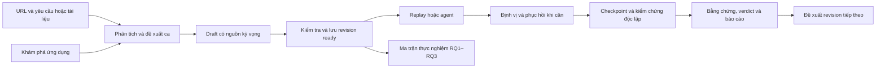
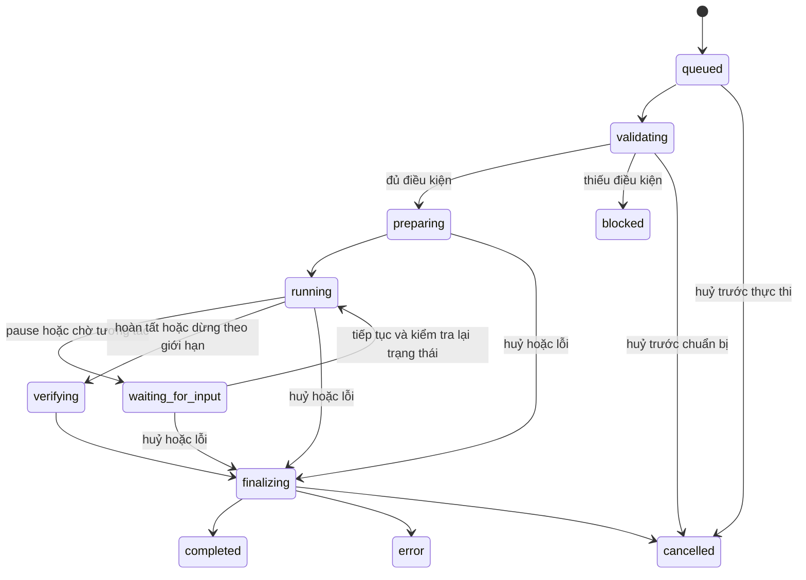

# AgentQA — đặc tả sản phẩm

- Ngày: 2026-10-06
- Phiên bản tài liệu: 1.0
- Trạng thái: Đã được chọn làm cơ sở thiết kế hệ thống; chưa triển khai
- Phạm vi: Toàn sản phẩm và ba câu hỏi nghiên cứu của đồ án
- Nguồn yêu cầu: [Product brief](../product-brief.md), [ba RQ](../research-questions.md)
- Cơ sở kỹ thuật: [Design evidence](../research/design-evidence.md)

## 1. Mục tiêu và quy tắc đọc

AgentQA biến yêu cầu nghiệp vụ thành ca kiểm thử có thể xem, sửa, lưu phiên bản, thực hiện bằng AI và chạy hồi quy trên trình duyệt thật. Mỗi kết luận có điều kiện kiểm chứng, bằng chứng và lịch sử quyết định để giải thích. Sản phẩm đồng thời cung cấp nền tảng thực nghiệm RQ1–RQ3 có đối chứng và dữ liệu tái lập được.

Tài liệu này định nghĩa hành vi bắt buộc, chưa chọn framework, database hoặc schema wire. Mã FR/NFR/AC là định danh truy vết cho thiết kế và kế hoạch sau. Từ "phải" biểu thị điều kiện nghiệm thu. Các khả năng model/provider phải qua kiểm tra tích hợp; không được báo đã hoạt động chỉ vì tài liệu vendor mô tả có hỗ trợ.

### 1.1. Các quyết định cố định

| Mã | Quyết định |
|---|---|
| D-01 | Giữ RQ1 hybrid vs vision-first, RQ2 phục hồi, RQ3 ổn định và chi phí so với baseline |
| D-02 | Có hai policy `llm` và `jev_cascade`; mặc định sản phẩm dùng cascade |
| D-03 | Jev: OpenCode Zen, `jev-1.13-free`, System One |
| D-04 | LLM: OpenCode Go, `deepseek-v4.1-flash`, Chat Completions; dùng cùng model cho nhánh LLM của cascade |
| D-05 | Chỉ triển khai hai route đã chọn; không tự thêm provider/model hay chuyển sang route trả phí |
| D-06 | Giữ năm lớp Contracts, Models, Agent, Verify, Platform; thiết kế bên trong mới hoàn toàn |
| D-07 | Replay là mặc định cho ca đã lưu; agent là chế độ tạo/thực thi linh hoạt riêng |
| D-08 | Kỳ vọng được giữ nguyên trong từng revision; phục hồi không được sửa nghĩa kiểm thử |
| D-09 | Web, CLI, API và CI dùng chung engine, quy tắc verdict và dữ liệu chạy |
| D-10 | Chất lượng, trải nghiệm, độ tin cậy và mức hoàn thiện quyết định thiết kế |

### 1.2. Phạm vi

Bao gồm workspace, yêu cầu, khám phá web, sinh ca, phiên bản ca, fixture/dữ liệu, engine agent/replay, phục hồi, kiểm chứng, điều phối, theo dõi trực tiếp, phân tích, báo cáo, lịch chạy, CI và thực nghiệm.

Triển khai sản phẩm theo kiểu local hoặc tự host cho nhóm. Không có yêu cầu về bán gói SaaS, billing khách hàng, huấn luyện/self-host model, tự vượt CAPTCHA hoặc agent điều khiển desktop. Đây là ranh giới sản phẩm, không phải giới hạn thời gian hoặc nhân lực. Tích hợp provider bổ sung được thực hiện bằng spec thay đổi sau.

## 2. Người dùng và cấu trúc workspace

| Vai trò | Công việc | Quyền trong workspace dùng chung |
|---|---|---|
| Owner | Quản trị workspace, môi trường, thành viên, credentials, retention | Toàn bộ; chỉ owner có quyền quản trị bí mật và chính sách truy cập |
| Editor | Viết yêu cầu, tạo/sửa/promote ca, quản lý suite | Sửa nội dung và chạy; không đọc giá trị credentials |
| Runner | Chạy, lập lịch và phân tích bộ ca đã sẵn sàng | Chạy với credential references được cấp; không sửa revision |
| Viewer | Đọc kết quả và bằng chứng đã được phép chia sẻ | Chỉ đọc; export theo quyền artifact |

Chế độ personal local có một owner, bind loopback mặc định. Chế độ shared hoặc bind ra mạng yêu cầu đăng nhập và kiểm tra quyền phía server. Credential, nguồn tài liệu, ca, run, report và experiment thuộc workspace; không chỉ lọc chúng ở giao diện.

Một workspace có các ứng dụng mục tiêu. Mỗi ứng dụng có environment như test/staging, URL gốc, danh sách origin được phép, dữ liệu/fixture, auth profile, viewport, locale/timezone và cấu hình chạy. Ca chỉ tham chiếu environment khi chạy để có thể dùng lại với cùng nghiệp vụ.

## 3. Hành trình chính

Ca được tạo từ yêu cầu và từ khám phá đi vào cùng một editor. Run không tự sửa revision đầu vào. Một run thành công có thể tạo đề xuất kịch bản hoặc locator mới; việc lưu đề xuất thành revision khác là thao tác riêng, có lịch sử thay đổi.

## 4. Khái niệm và vòng đời dữ liệu

| Khái niệm | Nội dung tối thiểu theo ý nghĩa |
|---|---|
| Requirement revision | Văn bản gốc, nguồn/đoạn trích, digest, phiên bản và người xác nhận nghiệp vụ |
| Case revision | Mục tiêu, tiền điều kiện, dữ liệu, steps/branch, checkpoint, assertions, nguồn kỳ vọng, trạng thái và digest |
| Suite revision | Các case revision cụ thể, tập dữ liệu, tham số và fixture dependencies |
| Target descriptor | Ý định thao tác, role/name, vùng ngữ cảnh, danh tính entity, locator alternatives và dữ kiện hình ảnh khi cần |
| Run snapshot | Revision đã resolve, cấu hình đã đóng băng, environment/fixture version, policy, model, observation, limits, cache và gate profile |
| Run / attempt | Lần chạy logic và các lần thử có định danh riêng, trạng thái, verdict, sự kiện, chi phí và bằng chứng |
| Healing event | Nguyên nhân, target gốc, candidates, quyết định, kiểm tra, target thực tế và kết quả |
| Experiment manifest | Tập dữ liệu, arms, biến thể, repetitions, thứ tự/seed hỗ trợ, chỉ số và phương pháp thống kê |
| Evaluation record | Oracle/ground truth, nhãn độc lập, kết quả chấm và provenance |

Đây là mô hình khái niệm; tên field/schema cụ thể thuộc thiết kế Contracts mới.

### 4.1. Revision ca

- Draft cho phép chỉnh, sinh bổ sung và chạy thử có kết quả provisional.
- Ready là revision bất biến và đủ điều kiện chạy hồi quy chính thức.
- Archived không được thêm vào lần chạy mới; run cũ vẫn đọc được với revision/digest đã pin.
- Sửa ready tạo draft mới. Run đang chạy không nhận thay đổi mới.
- Promote ready cần người có quyền xác nhận nội dung kỳ vọng qua UI hoặc API. Không biến điều AI suy ra từ trang thành chuẩn nghiệp vụ bằng thao tác tự động của agent.
- Một revision ready có ít nhất một assertion nghiệp vụ bắt buộc; tất cả assertion bắt buộc có nguồn và checkpoint hợp lệ. Draft chưa đạt điều kiện này không được tạo CI gate thành công.

### 4.2. Thay đổi yêu cầu

Requirement revision mới đánh dấu các ca liên quan cần xem xét, chỉ rõ assertions/steps bị ảnh hưởng. Ca đã pin vẫn có thể chạy để so hồi quy phiên bản cũ; UI hiển thị nó chưa theo yêu cầu mới. Không tự cập nhật kỳ vọng của những ca này.

## 5. Yêu cầu về tạo ca và khám phá

| Mã | Hành vi bắt buộc | Tiêu chí nghiệm thu |
|---|---|---|
| FR-01 | Tạo ứng dụng/environment với origins, viewport, locale, dữ liệu và auth references | URL hoặc credential reference sai bị báo trước khi mở browser; cấu hình run pin được |
| FR-02 | Nhận mô tả tiếng Việt, Markdown/text, PDF và DOCX; giữ nguồn theo revision | Trích nguồn theo mục/trang; file scan không đọc được báo rõ, không tạo nội dung giả |
| FR-03 | AI đề xuất ca dương, âm và biên; liên kết từng ca với yêu cầu | Mỗi ca có mục tiêu và expected outcome; không tự invent quy tắc nghiệp vụ thiếu nguồn |
| FR-04 | Sinh assertion có scope, entity và checkpoint, phân biệt nguồn người dùng/tài liệu/suy luận | Câu kỳ vọng mơ hồ được đánh dấu trong draft; không promote khi assertion bắt buộc còn mơ hồ |
| FR-05 | Editor dạng hội thoại và cấu trúc; undo/redo, diff revision, validation | Đổi một assertion hiện diff và tạo revision mới khi ca đã ready; run cũ không đổi |
| FR-06 | Khám phá theo origins và action policy được cấu hình, lập bản đồ luồng và đề xuất ca | Kết thúc có danh sách trang/luồng đã đi, các phần chưa quan sát và bằng chứng; không gọi đó là coverage đầy đủ |
| FR-07 | Quản lý suites, tags, data-driven cases và fixture dùng lại | Mỗi bộ tham số là execution riêng, có định danh và kết quả; thứ tự test độc lập mặc định |
| FR-08 | Import/export ca và suite theo định dạng có version, mặc định YAML/JSON | Round trip giữ ngữ nghĩa/digest; import không chạy code, không nhập secret value và không ghi đè revision |
| FR-09 | Agent chạy thử draft, đề xuất kịch bản có cấu trúc từ thao tác thực | Kịch bản phân biệt steps, dữ liệu động và assertions; successful trace chưa đủ để tự promote ready |

Khám phá mặc định chỉ thực hiện hành động đọc và điều hướng. Những hành động ghi dữ liệu được phép khi environment khai báo sandbox/test data và action policy cho phép; thao tác ngoài phạm vi bị chặn với lý do. Người dùng cấu hình quyền một lần ở environment, không cần trả lời một hộp xác nhận cho mỗi thao tác hợp lệ.

Coverage sản phẩm gồm requirement coverage có liên kết ca và execution coverage của ca đã khai báo. Không hiển thị "100% website coverage" từ crawler hoặc số trang đã đi.

## 6. Engine và khả năng tương tác

### 6.1. Ba chế độ chạy

| Chế độ | Hành vi |
|---|---|
| `agent` | Thực hiện mục tiêu bằng quan sát và policy, đồng thời tuân thủ assertions đã pin |
| `replay_strict` | Thực hiện đúng kế hoạch đã lưu, không đổi target bằng AI; lỗi định vị được ghi riêng |
| `replay_healing` | Thực hiện kế hoạch đã lưu, cho phục hồi target theo quy tắc mục 8 |

Ready mặc định `replay_healing`. Run record luôn ghi chế độ đã resolve. Không tự đổi replay thành agent toàn ca khi một step hỏng; người dùng có thể tạo run agent mới liên kết run cũ.

### 6.2. Hành động

Engine phải hỗ trợ điều hướng, click/double-click, fill/type/clear, press, check/uncheck, select, hover, scroll, upload file, chờ điều kiện và điều khiển tab/frame. Hỗ trợ dialog có hành vi khai báo, nhận download để kiểm tra và nhiều context trong một ca cần nhiều vai trò. Tham chiếu file phải ở kho file đã cho phép, không do LLM chỉ đường dẫn tuỳ ý trên máy host.

Định vị hỗ trợ role/label/text/test ID, scope theo vùng/entity, CSS khi cần, frame và shadow DOM được browser adapter hỗ trợ. Với canvas hoặc phần tử thuần ảnh, dùng grounding thị giác kèm context và kiểm tra tọa độ; không coi ảnh/tọa độ cũ là locator ổn định.

| Mã | Hành vi bắt buộc | Tiêu chí nghiệm thu |
|---|---|---|
| FR-10 | Pin cấu hình/revision và tạo browser context riêng cho execution | Hai ca song song không dùng chung cookies/local storage; dữ liệu backend được cô lập/reset riêng |
| FR-11 | Kiểm tra tiền điều kiện, actionability, uniqueness và đúng scope trước hành động | Hai nút cùng nhãn không tự chọn nút đầu; target không hợp lệ không được thực thi |
| FR-12 | Hỗ trợ các nhóm hành động, tab/frame và file ở mục 6.2 | Bộ nghiệm thu có một ca cho mỗi nhóm; capability không hỗ trợ bị báo rõ trước khi chạy |
| FR-13 | Nhánh và loop declarative có điều kiện rõ và bound; giá trị động có capture/assertion | Replay chạy đúng branch theo dữ liệu mới; không chép ID/token của lần authoring làm hằng |
| FR-14 | Kiểm tra postcondition trước khi chuyển step; kết thúc theo completion criteria | Agent nói hoàn thành khi checkpoint chưa đạt không tạo verdict passed |
| FR-15 | Quản lý retries theo khả năng lặp an toàn, ghi mọi attempt | Timeout sau khi tạo entity không làm tạo thêm entity lần hai khi chưa xác minh outcome |
| FR-16 | Báo capability bị thiếu hoặc cấu hình không hợp lệ, có lỗi phân loại | Không biến unsupported action, hết quota hoặc lỗi model thành lỗi nghiệp vụ của website |

Một lỗi attempt đã phục hồi đúng không tự làm thất bại toàn ca. Ca phải được đánh giá theo kế hoạch, checkpoints, final assertions và độ đầy đủ của bằng chứng, đồng thời vẫn hiển thị các attempt đã lỗi.

## 7. Policy, quan sát và provider

### 7.1. Route ban đầu

| Thành phần | Model | Base URL | Giao thức | Credential reference |
|---|---|---|---|---|
| Jev | `jev-1.13-free` | `https://opencode.ai/zen/v1` | `systemone` | `AGENTQA_JEV_API_KEY` |
| LLM | `deepseek-v4.1-flash` | `https://opencode.ai/zen/go/v1` | `chat` | `AGENTQA_LLM_API_KEY` |

Route/model được đối chiếu với [OpenCode Zen](https://opencode.ai/docs/zen/) và [OpenCode Go](https://opencode.ai/docs/go/). Base URL không bao gồm đường dẫn thao tác; adapter thêm `/systemone` hoặc `/chat/completions` đúng một lần. Giá trị mẫu nằm trong `.env.example`; key không được đặt trong ca, prompt hoặc tài liệu.

Models dùng hai adapter giao thức riêng và một kết quả nội bộ chuẩn hoá. Không sử dụng client chat để parse Jev System One. Chỉ có cấu hình cho hai route ban đầu; provider mới chưa thuộc phần triển khai. User-Agent nhận diện AgentQA và session Go ổn định theo run/conversation; mỗi attempt retry của cùng conversation giữ session.

### 7.2. LLM thuần và cascade

`llm` nhận quan sát, kế hoạch/mục tiêu và lịch sử đã tóm tắt; trả đề xuất action có cấu trúc. Đề xuất phải qua validation và kiểm tra target bằng engine. Ghi dữ kiện/lý do được cung cấp, không yêu cầu hoặc trình bày chain-of-thought nội bộ.

`jev_cascade` dùng Jev cho quyết định đóng như chọn action/target, đánh giá tiến triển hoặc candidate phù hợp. LLM xử lý lập kế hoạch, giá trị cần sinh, thị giác và escalation. Jev không sinh giá trị fill hoặc giải thích tự do. Engine kết hợp câu trả lời độc lập bằng code; ngưỡng không dùng để bỏ qua action policy, precondition hoặc assertion.

Policy không được truy cập oracle thực nghiệm. Jev hoặc LLM có thể đề xuất dừng, nhưng Verify và completion criteria quyết định verdict. Khi provider lỗi, cascade chỉ escalation sang LLM đã chọn nếu cấu hình run cho phép; run ghi policy degradation. Arm nghiên cứu có thể đặt không cho degradation để giữ thiết kế đối chứng; không loại các lượt bị lỗi khỏi dữ liệu.

### 7.3. Các chế độ quan sát

- `semantic`: biểu diễn cấu trúc/ngữ nghĩa, không gửi ảnh; là arm ablation riêng.
- `hybrid`: ngữ nghĩa mặc định; yêu cầu ảnh khi target thuần hình ảnh, semantic grounding mơ hồ hoặc bằng chứng quan sát không đủ. Ghi trigger, ảnh đã gửi và chi phí escalation.
- `vision_first`: ảnh viewport và mark/geometry làm đầu vào chính tại mỗi bước quyết định. Không gửi text/role/name lấy từ DOM làm ngữ cảnh policy. Engine vẫn có thể dùng DOM để thực thi và Verify để kiểm chứng; nguồn dữ liệu này không được đưa ngược vào policy như gợi ý target.

RQ1 dùng cùng policy LLM và khả năng hành động; marker số có thể ánh xạ tới phần tử trong executor, nhưng không chứa nhãn ngữ nghĩa DOM. History chung chỉ chứa hành động/outcome quan sát được, không bổ sung semantic text cho arm vision-first. Chốt quy tắc mark và image preprocessing trong thiết kế quan sát.

| Mã | Hành vi bắt buộc | Tiêu chí nghiệm thu |
|---|---|---|
| FR-17 | Hai policy, cấu hình và phiên bản prompt/question được pin | Chạy cùng ca bằng hai policy, Verify/fixtures giống nhau, model calls truy được về policy |
| FR-18 | Jev ghi state đã redaction, question/candidate set, câu trả lời và tín hiệu quyết định | Thiếu answer, NaN/out-of-range, unknown target hoặc option truncation không tạo action liều lĩnh |
| FR-19 | Quan sát theo ba chế độ, có accounting và provenance riêng | Audit input của vision-first không chứa semantic DOM; hybrid có ca bắt buộc dùng ảnh |
| FR-20 | Kiểm tra khả năng ảnh và output/schema của route thật trước khi bật tính năng phụ thuộc | Route không nhận ảnh chặn arm cần ảnh; không đổi sang model khác hoặc gọi text-only là vision-first |
| FR-21 | Provider errors/retries có phân loại và không tự đổi provider/model | Free/quota không còn dùng được hiện rõ nguyên nhân; không chuyển sang `jev-1.13` trả phí |

Confidence và xác suất là tín hiệu lựa chọn, không là bằng chứng đúng. Bộ thresholds có version, chọn trên calibration và giữ cố định trong evaluation; không kế thừa 0.8/0.6 của code cũ.

## 8. Replay và phục hồi

Một step replay lưu ý định và nhận diện target theo scope/entity, locator alternatives, trạng thái cần có, postcondition và thông tin cần capture. Replay dùng dữ liệu runtime theo tham số/capture; assertion không phụ thuộc chuỗi đã tình cờ thấy ở lần ghi ca.

Một locator vẫn resolve được có thể đã trỏ nhầm phần tử. Kiểm tra semantic identity và scope phải thực hiện cả khi không có exception. Nếu nhiều candidate tương đương hoặc bằng chứng không phân biệt được, không tự chọn ngẫu nhiên.

Luồng phục hồi: phát hiện mismatch → lấy target descriptor đã lưu → tạo candidates từ quan sát hiện tại → so tương đồng/context → dùng policy khi cần → kiểm tra candidate trước hành động → thực thi → kiểm tra postcondition → ghi sự kiện. Không thử click tuần tự từng candidate để xem cái nào làm assertion đạt.

| Mã | Hành vi bắt buộc | Tiêu chí nghiệm thu |
|---|---|---|
| FR-22 | Guard target trước mỗi step, cả target còn resolve | Biến thể có nút sai nhận ID cũ được phát hiện; hệ thống không click chỉ vì selector tồn tại |
| FR-23 | Phục hồi được cả locator hỏng và semantic mismatch, có phương án từ chối | Trong fixture biết target, đổi ID giữ nghiệp vụ có thể phục hồi; hai candidate không phân biệt dẫn tới từ chối |
| FR-24 | Giữ nguyên mục tiêu, dữ liệu nghiệp vụ, branch và assertions trong run | Ca thao tác nhầm entity không được chữa bằng cách đổi expected outcome |
| FR-25 | Lưu đầy đủ sự kiện, kiểm tra và phần tử thực tế; đề xuất locator mới thành revision riêng | Run có badge phục hồi; ca ready không đổi sau run; diff proposal truy được về sự kiện |
| FR-26 | Phục hồi locator của assertion chỉ khi giữ nguyên identity/scope/comparator/value, theo policy riêng | Ghi evidence-target recovery riêng; không chọn bằng chứng dựa trên việc nó làm expectation đạt |

Thay label có thể là thay đổi giao diện hợp lệ hoặc đổi nghĩa thao tác. Healer cần bằng chứng semantic/context; không coi mọi đổi label là trường hợp phải chữa. `replay_strict` không bật FR-23/FR-26, nhưng vẫn thực hiện guard và ghi lỗi.

## 9. Kiểm chứng và kết luận

### 9.1. Assertion

Verify hỗ trợ visible/hidden/absent, text exact/contains/regex, URL có cấu trúc, value, enabled/disabled, checked, count, thuộc tính và quan hệ entity. Có bằng chứng cho download, network/API response được environment cho phép và visual regression với baseline được quản lý phiên bản. Network assertion không thay thế UI assertion nếu yêu cầu nghiệp vụ đòi bằng chứng UI.

Assertion đặt tại checkpoint cụ thể hoặc cuối ca; có scope, comparator, expected value, nguồn và mức bắt buộc. Có assertion cho phủ định, uniqueness và dữ liệu động; không chỉ tìm chuỗi con toàn trang. Visual comparison có masks và tolerance versioned; AI có thể giải thích diff, không tự thay baseline để ca đạt.

Assertion code sinh tự do không được chạy trực tiếp trong host process. Định dạng ca chính là DSL được validation; extension thực thi code thuộc giao diện kiểm chứng được kiểm soát, có version và quyền riêng trong thiết kế hệ thống.

### 9.2. Ba chiều kết quả

| Chiều | Giá trị | Ý nghĩa |
|---|---|---|
| Execution status | Trạng thái vòng đời ở mục 11 | Engine đang làm gì, đã kết thúc bằng cách nào |
| Verdict | `passed`, `failed`, `inconclusive` | Kết luận nghiệp vụ theo các điều kiện đã khai báo |
| Annotations | healed, retried, degraded, provisional, evidence_partial | Các thuộc tính giải thích; không được giấu trong một chữ passed |

`passed` cần hoàn thành kế hoạch/completion criteria, mọi assertion bắt buộc qua với bằng chứng hợp lệ và đủ dữ liệu bắt buộc. Một assertion bắt buộc false có bằng chứng đáng tin tại checkpoint đạt điều kiện đánh giá tạo `failed`. Thiếu checkpoint, lỗi kiểm chứng hoặc không đủ bằng chứng tạo `inconclusive` nếu chưa có thất bại nghiệp vụ đủ căn cứ. Một thất bại nghiệp vụ đã chứng minh được giữ `failed` dù về sau có lỗi hệ thống; ghi thêm lỗi và những assertion chưa đánh giá.

Run đang active có verdict chưa chốt; UI hiển thị "Chưa có kết luận", không hiển thị passed mặc định. Mọi terminal run có verdict hoặc kết luận provisional được đánh dấu, và status/gate luôn xét riêng.

Không được tính `all([])` thành passed. Kết quả draft/exploration chỉ provisional và không đạt CI gate. Attempt đã lỗi nhưng được phục hồi đúng có thể kết thúc passed kèm annotations. Việc agent phát action finish không phải điều kiện đủ hoặc bắt buộc riêng cho passed: engine xác nhận completion theo ca và evidence.

### 9.3. Gate profile

- `strict` mặc định cho CI: chỉ chấp nhận execution completed, verdict passed, revision ready, evidence bắt buộc đủ, không healed và không policy degraded.
- `allow_healing`: chấp nhận passed có phục hồi đã qua các guard/postcondition; vẫn từ chối degraded/provisional/inconclusive hoặc evidence bắt buộc thiếu.
- Các exclusions/expected failures được khai báo có version trước run; không tự chuyển thất bại thành skipped sau khi xem kết quả.
- Gate rejection và business verdict là hai kết quả riêng. Một ca passed có healing bị strict gate từ chối không bị đổi thành "ứng dụng lỗi".

| Mã | Hành vi bắt buộc | Tiêu chí nghiệm thu |
|---|---|---|
| FR-27 | Chạy Verify độc lập tại checkpoint/final, không dùng lời nói policy làm assertion | Agent báo xong nhưng expected entity không tồn tại tạo failed hoặc inconclusive đúng căn cứ |
| FR-28 | Assertion được validation, retry theo điều kiện và lưu evidence | Sai scope, comparator hoặc value bị báo trước run; hết wait ghi observed vs expected |
| FR-29 | Verdict theo mục 9.2 và gate theo mục 9.3 | Bảng truth fixtures AC-04/05/06/07/08 đều cho kết quả đã quy định |
| FR-30 | Visual baseline/version và kết quả diff được bảo toàn | Run không tự cập nhật baseline; tolerance change là revision có diff |
| FR-31 | Diễn giải nguyên nhân có mức chắc chắn và liên kết bằng chứng | AI diagnosis là đề xuất riêng; không sửa verdict hoặc gọi lỗi locator là lỗi ứng dụng khi chưa có căn cứ |

## 10. Giao diện sản phẩm

### 10.1. Các màn hình

| Màn hình | Nội dung và thao tác chính |
|---|---|
| Workspace overview | Ứng dụng/environment, ca/suites, run gần đây, thay đổi yêu cầu, lỗi cần xem và usage có nguồn |
| Requirements | Nguồn tài liệu, revision, ca liên quan, coverage có định nghĩa và tác động khi sửa yêu cầu |
| Case editor | Mục tiêu, steps/branch, dữ liệu, secret references, assertions/checkpoints, nguồn, diff, validation, run thử và promote |
| Suite | Phiên bản ca cụ thể, data sets, fixtures, tags, lịch chạy và gate profile |
| Live run | Browser view, timeline, bước hiện tại, hành động, evidence, nguồn quyết định, usage, pause/cancel và trạng thái chờ |
| Run detail | Verdict/gate, expected vs observed, attempt errors, healing diff, diagnostics, artifact và cấu hình đã pin |
| Compare runs | So hai run theo step/checkpoint/ca, dữ liệu, target, ảnh, policy, chi phí và khác biệt cấu hình |
| Experiments | Manifest, arms/variants/repetitions, calibration, tiến độ, validity checks, oracle scoring, biểu đồ và export |
| Settings | Environment, auth/secret references, thành viên/quyền, hai route model, retention, worker health và budgets |

### 10.2. Những điểm cần làm rõ bằng UI

Trong case editor, người dùng thấy assertion đang dựa trên yêu cầu nào và phần nào AI tự suy luận. Trong live run, hiển thị sự kiện/hành động và dữ kiện quyết định; không giả lập suy nghĩ nội bộ của model. Khi phục hồi, hiển thị target cũ, target mới, căn cứ kiểm tra và việc thay đổi đã được lưu thành revision hay chưa.

Run detail mở đầu bằng kết luận, checkpoint thất bại đầu tiên có căn cứ, tình trạng evidence và cách đọc các annotations. Một target mismatch hoặc AI diagnosis có mức chắc chắn thấp không bị trình bày như lỗi ứng dụng đã xác nhận. "Không có dữ liệu chi phí" và "chi phí bằng zero" phải khác nhau bằng cả text và giá trị dữ liệu.

| Mã | Hành vi bắt buộc | Tiêu chí nghiệm thu |
|---|---|---|
| FR-32 | Live timeline và browser view liên kết step/events; reconnect theo cursor | Mất kết nối UI không dừng engine; mở lại thấy các sự kiện đã mất đúng thứ tự, không lặp |
| FR-33 | Case editor và run detail hỗ trợ truy từ yêu cầu đến assertion/evidence | Click assertion mở đúng evidence/checkpoint và source revision; không dùng bằng chứng từ run khác |
| FR-34 | Compare runs kiểm tra tính tương thích trước khi so | Ca/config khác hiện khác biệt; không quy chênh lệch do đổi model thành hiệu quả observation |
| FR-35 | Tìm/lọc run theo verdict, lỗi, healing, policy, environment, ca và khoảng ngày | Kết quả phân trang ổn định; tổng đếm khớp dữ liệu đã phân quyền |
| FR-36 | Tạo issue package từ một lỗi: tóm tắt, bước, expected/observed, cấu hình và bằng chứng | Package redacted, có provenance và tải được; không tự gửi tới người khác hoặc dịch vụ ngoài |

## 11. Điều phối và vòng đời run

### 11.1. Trạng thái

| Trạng thái | Ý nghĩa |
|---|---|
| `queued` | Đã nhận yêu cầu và pin snapshot, chờ thực thi |
| `validating` | Kiểm tra revision, quyền, capability, cấu hình, fixture và budget |
| `preparing` | Chuẩn bị dữ liệu, browser và auth |
| `running` | Đang thực hiện bước/checkpoint |
| `waiting_for_input` | Đang pause theo yêu cầu hoặc chờ tương tác ngoài như đăng nhập thủ công |
| `verifying` | Đánh giá các điều kiện cuối có thể kiểm tra |
| `finalizing` | Đóng session, cleanup và chốt bằng chứng/kết quả |
| `completed` | Engine đã kết thúc hợp lệ; đọc verdict riêng |
| `blocked` | Không đủ điều kiện bắt đầu hoặc bị chặn bởi cấu hình/quyền/capability |
| `error` | Lỗi hệ thống/provider/worker ngăn hoàn tất engine |
| `cancelled` | Người dùng hoặc lịch điều phối huỷ |

Trạng thái terminal: completed, blocked, error, cancelled. Chuyển sang terminal sau khi chốt phần dữ liệu có thể lưu; không chờ vô hạn việc ghi artifact hoặc cleanup lỗi. Run giữ cleanup/evidence errors và verdict đã có căn cứ. Run bị huỷ/error không được gate thành công dù đã có assertion passed trước đó.

Lỗi hoặc huỷ trong verifying cũng chuyển finalizing. Blocked ghi kết quả validation và không tạo browser. Nếu giới hạn tài nguyên dừng chạy, engine có thể completed với verdict inconclusive và reason tương ứng; không biến việc cạn budget thành assertion nghiệp vụ false. Thời hạn chờ, step, provider call và finalization là cấu hình vận hành được pin.

### 11.2. Thực thi tin cậy

Mỗi request tạo run có idempotency key; gửi lại cùng key và cùng input trả cùng run, khác input báo conflict. Run logic, attempt, worker và event có định danh riêng. Worker ownership có fencing để một job không được hai worker cùng thao tác. Crash sau side effect chưa rõ kết quả không được tự chạy lại step đó; ghi uncertainty và áp cơ chế FR-15.

Pause có hiệu lực tại ranh giới an toàn sau thao tác đang diễn ra, không đóng giả rằng request đã bị huỷ ở website. Resume kiểm tra trạng thái lại, ghi thao tác thủ công nếu có, không thay snapshot; run có thay đổi ngoài engine được chú thích và không dùng làm lượt đối chứng sạch. Cancel ngăn lập action mới, đóng context và chạy cleanup có bound.

Suite snapshot tạo mọi execution dự kiến trước khi chạy. Mỗi execution terminal hoặc có trạng thái chưa chạy giải thích được; fail-fast không làm biến mất các ca bị skipped. Retrun ca thất bại là attempt/run mới, không ghi đè lần cũ. Dependencies chỉ dành cho fixture/setup được khai báo, không yêu cầu một ca phải chạy đạt mới có dữ liệu ngầm cho ca sau.

| Mã | Hành vi bắt buộc | Tiêu chí nghiệm thu |
|---|---|---|
| FR-37 | Queue/worker pool, limits theo workspace/environment/provider và dữ liệu cô lập | Chạy đồng thời không trùng ownership, không vượt giới hạn đã cấu hình và không làm lẫn fixture |
| FR-38 | Pause/resume/cancel và recovery khi worker/server mất kết nối | Không tạo thêm action sau cancel acknowledgement; crash để lại record có nguyên nhân và partial evidence |
| FR-39 | Suite/data matrix, rerun, fail-fast và lịch chạy theo timezone | Không bỏ sót execution dự kiến; DST/overlap policy hiển thị và occurrence được định danh duy nhất |
| FR-40 | Fixture setup/reset/cleanup có version và kiểm tra outcome | Fixture setup lỗi không gọi ca; cleanup lỗi không mất business failure đã chứng minh |
| FR-41 | Idempotent submit và fencing worker | Gửi lại request không tạo thêm side effect; stale worker không ghi action/terminal event hợp lệ |

Lịch chạy có timezone IANA, xử lý giờ không tồn tại bằng skip có record, giờ lặp bằng occurrence một lần, mặc định skip lượt lịch mới nếu lượt trước cùng schedule còn active. Có thể chọn queue overlap bằng cấu hình có version. Không tự bắt kịp lịch đã bỏ lỡ sau downtime bằng loạt run bất ngờ.

## 12. Trace, artifacts và kế toán

### 12.1. Dữ liệu bắt buộc

| Nhóm | Nội dung |
|---|---|
| Provenance | IDs/digests của yêu cầu, ca, suite, fixture, application build, variant, code, schema, browser, model và prompts/questions |
| Configuration | Snapshot đã resolve, mode, policy, observation, thresholds, budgets, viewport, locale/timezone, cache/gate và capability evidence |
| Timeline | Events có sequence, timestamp, bước/attempt, queue wait và thời gian quan sát/quyết định/thực thi/kiểm chứng riêng |
| Observation | Input policy đã redaction, kích thước, truncation/selection, nguồn và image artifact được gửi |
| Model call | Call/attempt/session/request IDs, route/model, input/output/cache/reasoning usage khi có, cost provenance, duration, lỗi/escalation |
| Action | Ý định, đề xuất và action thực tế, target descriptor/candidates, target trước hành động, kết quả và capture values đã redaction |
| Verification | Assertion/checkpoint IDs, expected/observed, trạng thái, evaluator version, evidence refs và lỗi |
| Healing | Target mismatch, candidate ranking, quyết định/từ chối, guard, element thực tế, outcome và proposal revision |
| Artifacts | Ảnh, visual diff, DOM/semantic capture, console/network đã lọc, download metadata và browser trace thích hợp |

AgentQA có event/verification trace riêng; browser trace là artifact bổ sung. BrowserContext tracing không tự ghi assertions của engine bên ngoài. [Playwright Tracing API](https://playwright.dev/python/docs/api/class-tracing).

Không đợi run thành công mới ghi trace. Dữ liệu và events được chốt dần; sự kiện cuối, kể cả finish decision, lỗi policy và cancellation, không bị mất khỏi kế toán. Event chưa xác minh là đề xuất phải khác event action đã thực thi. Artifact references có integrity digest và tình trạng available/missing/redacted/expired.

### 12.2. Usage và chi phí

- Mọi call được tính, gồm authoring, sinh assertion, value generation, healing, diagnostics, retries và những call cuối để đề xuất dừng. Diagnostic sau run có ledger liên kết riêng, không âm thầm cộng vào thời gian/chi phí engine đã chốt.
- Tách provider-reported usage, local estimate và thiếu dữ liệu. Cache read tokens không cộng lần hai vào tổng nếu provider đã bao gồm; adapter phải có semantics được xác minh.
- Chi phí có trạng thái reported/estimated/partial/unknown, currency và nguồn. Tổng thiếu một call không được hiển thị như tổng đầy đủ.
- Free có thể bằng zero khi có provider report hoặc price snapshot xác minh, ghi rõ loại bằng chứng. Không mặc định zero chỉ vì tên model có `free`.
- Với Go, tách usage/quota consumption, giá trị ước tính theo bảng giá và khoản thanh toán tiền mặt. Phân bổ phí subscription cho một ca phải ghi phương pháp và số lượt; không coi từng call miễn phí là tổng chi phí hệ thống bằng zero.
- Lưu price snapshot và timestamp khi ước tính; không tính lại run cũ bằng giá mới. Giá chưa biết hoặc usage failed call không có phải được giữ unknown.
- Wall time không bằng tổng duration song song. Tách queue time, preparation, active execution, waiting, finalization và thời gian toàn suite.
- Cache quyết định/hành động phải phân biệt với cache provider. Cache key bao gồm scope workspace, revisions, cấu hình và context phù hợp; cache không được cấp quyền hoặc secret value. Một cache hit không chứng minh trạng thái hiện tại phù hợp với action.

| Mã | Hành vi bắt buộc | Tiêu chí nghiệm thu |
|---|---|---|
| FR-42 | Trace của mọi outcome, có integrity và provenance; lưu dần | Worker chết sau một step vẫn đọc được cấu hình/step đã chốt và trạng thái thiếu dữ liệu |
| FR-43 | Usage/cost theo từng call và từng pha, không mất call hoặc đếm hai lần | Fixture có retry, finish và parallel calls cho tổng đúng, thiếu cost hiện partial/unknown |
| FR-44 | Quản lý artifacts, quyền đọc, redaction, retention và export | Artifact hết hạn có metadata giải thích; người không có quyền không đọc qua URL trực tiếp |
| FR-45 | Cache có namespace, trạng thái hit/miss/bypass và guard khi dùng lại | Context/revision thay đổi không replay action sai; experiment bypass local cache có bằng chứng |

Chi phí thiếu không tự làm business verdict inconclusive khi bằng chứng nghiệp vụ vẫn đủ. Nó làm chỉ số chi phí không hợp lệ hoặc partial và phải hiện trong báo cáo/thực nghiệm. Phân biệt bằng chứng bắt buộc cho verdict với dữ liệu bắt buộc để kết luận nghiên cứu.

## 13. Hệ thực nghiệm RQ1–RQ3

### 13.1. Manifest và bộ đánh giá

Experiment được khai báo và đóng digest trước evaluation: benchmark version, case/fixture/application revisions, arms, variants, repetitions, calibration split, budgets, cache policy, model settings, thứ tự chạy và phương pháp phân tích. Pilot/calibration tách khỏi evaluation. Không sửa threshold sau khi xem kết quả rồi giữ tên manifest cũ.

Benchmark gồm nhiều ứng dụng có thể kiểm soát, phủ luồng ghi dữ liệu, validation âm, dữ liệu động/bất đồng bộ, bảng có nhiều entity, tab/frame, file và tình huống cần thị giác. Các ca có expected outcomes độc lập. Bộ nghiệm thu có ít nhất ba ứng dụng thuộc ba nhóm: giao dịch/dữ liệu, UI động và tương tác thị giác; số case/repetitions của thí nghiệm chính được chốt theo mục tiêu độ chính xác thống kê trong protocol, không chọn theo kết quả thuận lợi.

Variant có bản gốc, operator/version, seed khi dùng, manifest thay đổi, kiểm tra đã áp dụng và oracle map. Nhóm giữ nguyên nghiệp vụ gồm ID/class, cấu trúc/vị trí, nhãn tương đương và phần tử gây nhầm. Nhóm lỗi nghiệp vụ gồm thao tác tác động nhầm entity, bỏ side effect, sai validation/trạng thái/kết quả. Variant không áp được hoặc tương đương không đủ điều kiện chấm được đánh dấu invalid với nguyên nhân; không sửa denominator âm thầm.

Ground truth và oracle chỉ evaluator truy cập. Không đặt đáp án vào prompt, semantic observation, image marks hoặc các thuộc tính DOM mà policy được đọc. Oracle có thể dùng nhận diện phần tử/runtime event ngoài input agent và kiểm tra backend fixture; sản phẩm Verify không được lấy câu trả lời từ oracle.

### 13.2. Ma trận bắt buộc

| RQ | Arms | Giữ chung | Dữ liệu chính |
|---|---|---|---|
| RQ1 | LLM agent + hybrid; LLM agent + vision-first; semantic là ablation | LLM/model/settings, nhiệm vụ, evaluator, browser, mark/grounding capabilities và environment | Input/output usage, ảnh, cost provenance, phase duration, số bước và oracle success |
| RQ2 | Replay strict; replay healing; phục hồi tương đồng; phục hồi dùng cascade | Kế hoạch/target gốc, fixture, biến thể, expectation và oracle | Detection, candidate/target đã dùng, healing outcome, refusal, false pass và task success |
| RQ3 | Kịch bản tĩnh; LLM agent; cascade agent; strict replay; healing replay | Cases, data, environment, checker/oracle tương đương và chế độ song song | Outcome consistency, failure rate, wall time, chi phí theo pha, usage và tổng qua nhiều lượt hồi quy |

Kịch bản tĩnh và replay strict phải có nguồn kế hoạch khác được mô tả: baseline tĩnh viết/kiểm tra độc lập, replay strict sinh từ bước authoring của AgentQA rồi đóng băng. Không đổi tên cùng một kế hoạch thành hai baseline độc lập mà không giải thích.

Bốn arm RQ2 được định danh rõ trong manifest: replay strict không healer; replay healing với LLM đã chọn; heuristic tương đồng không gọi model; replay healing dùng Jev–LLM cascade. Chúng dùng cùng target descriptors/guards và corpus calibration, không chỉ đổi tên cấu hình giống nhau.

RQ1 không trộn thay đổi policy vào observation comparison. RQ2 không tính target agent chọn từ đầu là locator healing. RQ3 báo cả chi phí tạo ca và chi phí tích luỹ theo số lượt replay; chi phí tạo baseline tĩnh không tự được giả định bằng zero. Các dữ liệu công bảo trì không có phải khai báo thiếu, không bịa số.

### 13.3. Định nghĩa chỉ số

| Chỉ số | Định nghĩa |
|---|---|
| Scheduled completion | Số execution có terminal record / số execution trong manifest |
| Oracle task success | Số execution hoàn thành đúng theo oracle / số execution evaluation hợp lệ đã lập lịch; lỗi/hết budget vẫn thuộc mẫu số |
| Detection precision | Số cơ hội mismatch được phát hiện đúng / mọi cơ hội được hệ thống đánh dấu mismatch |
| Detection recall | Số cơ hội mismatch được phát hiện đúng / mọi cơ hội mismatch theo oracle |
| Correct healing | Số lần phục hồi chọn và tác động đúng target theo oracle / mọi lần thử phục hồi |
| False healing | Số lần phục hồi dùng target sai theo oracle / mọi lần thử phục hồi, bất kể verdict cuối |
| Refusal rate | Số cơ hội phục hồi bị từ chối / mọi cơ hội được phát hiện cần phục hồi; tách refusal đúng/sai theo oracle |
| False pass | Số execution verdict passed nhưng oracle task false / mọi execution oracle task false có đủ dữ liệu chấm |
| Verdict consistency | Tần suất signature execution status + verdict phổ biến nhất / số repetitions của cùng tổ hợp |
| Escalation rate | Số bước cascade chuyển sang LLM free-form / số bước có quyết định cascade; value-only và vision call tách riêng |
| Image escalation | Số bước hybrid gửi ảnh / số bước quyết định hybrid |

Một step/variant/target tạo một cơ hội detection được định danh; retry không tạo thêm cơ hội cùng mismatch nhưng tạo healing attempts riêng. Không có mẫu số thì giá trị là not-applicable, không phải 0% hoặc 100%. Signature consistency cao khi toàn bộ run error không được gọi là chất lượng cao; luôn đọc cùng oracle success/error rate.

Không chấm false pass khi oracle không có dữ liệu; báo số unscorable và coverage oracle riêng. Cost comparison chỉ dùng dữ liệu cùng loại reported/estimated phù hợp, hiển thị tỷ lệ thiếu; không gộp unknown thành zero. Báo phân bố, paired differences theo case, độ bất định và cấu hình khác biệt. Cache provider nếu không thể tắt phải ghi usage/cache state và tách cold/warm, không tuyên bố tất cả đều cold.

| Mã | Hành vi bắt buộc | Tiêu chí nghiệm thu |
|---|---|---|
| FR-46 | Manifest versioned, calibration/evaluation tách, thực thi ma trận và scoring độc lập | Chạy lại manifest tạo run mới cùng cấu hình pin; oracle không xuất hiện trong input policy |
| FR-47 | Generator biến thể có ground truth và validity check | Biến thể apply fail không được coi là test passed; behavior-preserving và bug variants chấm riêng |
| FR-48 | Dashboard/export thống kê theo định nghĩa, có dữ liệu gốc | Tính lại chỉ số từ export khớp UI; denominator/missingness/invalid variants truy được |

## 14. CLI, API và CI

Giao diện tích hợp cung cấp tạo/import/export revision, submit/query/cancel run, chạy suite, tạo/chạy/query experiment, đọc events và tải artifact theo quyền. Các endpoint và schema được chốt trong thiết kế API mới. Submit có idempotency, lỗi validation có field path và không trả secret; event subscriptions có cursor để reconnect.

CLI có nhóm chức năng tương ứng, output tiếng Việt cho người và JSON có version cho automation. Run có thể detached hoặc chờ terminal; Ctrl+C huỷ chỉ trong chế độ đã khai báo ownership, không tự huỷ run shared do người khác submit. Báo cáo xuất JSON, CSV/JSONL cho nghiên cứu, HTML cho đọc và JUnit XML cho CI. JUnit thể hiện gate rejection của healed/inconclusive bằng failure/error có message rõ, không ghi chúng thành pass hoặc skipped ngầm.

| Mã thoát khi chờ run/suite | Điều kiện theo thứ tự ưu tiên |
|---|---|
| 64 | CLI input/configuration không hợp lệ, chưa submit |
| 130 | Đã submit và lượt chạy bị huỷ |
| 2 | Có execution blocked/error, inconclusive hoặc gate rejection ngoài business failure |
| 1 | Có business verdict failed, không thuộc điều kiện ưu tiên cao hơn |
| 0 | Mọi execution bắt buộc completed và đạt gate; có ít nhất một execution bắt buộc |

Các mã trên là quyết định giao diện của sản phẩm. Detached submit thành công dùng mã 0 kèm run ID và không được diễn giải là ca đã đạt. Gate trả cả business verdict và gate reasons trong JSON/JUnit.

| Mã | Hành vi bắt buộc | Tiêu chí nghiệm thu |
|---|---|---|
| FR-49 | Web/API/CLI có cùng cấu hình resolve, verdict và gate | Cùng fixture/snapshot qua ba giao diện cho kết luận tương đương, không có checker riêng bị lệch |
| FR-50 | JSON/CSV/JSONL/HTML/JUnit export có provenance và secrets redaction | CI thất bại trên inconclusive/healed strict; research export giữ mọi execution/attempt |
| FR-51 | CI workflow template và callback/webhook tuỳ chọn do owner cấu hình | Callback chỉ gửi tới destination đã cho phép, có chữ ký/idempotency; không tự gửi email/issue |

## 15. Yêu cầu phi chức năng

| Mã | Yêu cầu | Điều kiện nghiệm thu |
|---|---|---|
| NFR-01 | Tính đúng đắn | Tất cả fixture truth-table và false-pass AC qua; không đánh đổi assertion để tăng pass rate |
| NFR-02 | Bí mật và dữ liệu | Secret canary không xuất hiện trong prompt/model state, log, event, image xuất hoặc export; auth header cho provider và executor fill là đường sử dụng có kiểm soát |
| NFR-03 | Cô lập và quyền | Từ chối cross-workspace access tại API/artifact/event; context isolation và fixture isolation được kiểm tra riêng |
| NFR-04 | Browser/host boundary | URL/redirect/websocket/file destinations bị kiểm tra theo environment; không nhận shell/Python tuỳ ý từ model |
| NFR-05 | Khả năng phục hồi | Restart worker/server không làm mất events đã chốt hoặc tạo side effect trùng; terminal outcome có nguyên nhân |
| NFR-06 | Tài nguyên | Step/call/wait/concurrency budgets được pin; giới hạn không làm cắt input/evidence mà không ghi nhận |
| NFR-07 | Khả năng quan sát | Có worker/provider health, queue metrics và structured errors; correlation truy từ API xuống call/action |
| NFR-08 | Trải nghiệm và accessibility | UI thao tác được bằng bàn phím, focus rõ, trạng thái không chỉ dựa màu, loading/error/empty có thông tin và hành động phù hợp |
| NFR-09 | Tương thích | Engine và CLI chạy trên Windows/Linux; web trên trình duyệt hiện đại; Chromium là browser nghiệm thu chuẩn |
| NFR-10 | Mở rộng/bảo trì | Cưỡng chế ranh giới năm lớp, interfaces versioned, schema migrations và capability declarations được kiểm tra |
| NFR-11 | Tái lập và backup | Export/import workspace metadata không gồm secrets, giữ revision/manifest; restore không làm mất liên kết evidence |
| NFR-12 | Kiểm thử | Test tự động offline fake/stub; live model conformance và nghiên cứu thật tách riêng, ghi usage và kết quả thật |

Secret values chỉ được resolve ở backend/executor cho đúng hành động, không cần model đọc chúng để chọn ô nhập. Browser screenshots/DOM/network có thể chứa bí mật sau khi điền; phải lọc/mask ở đường thu thập và kiểm tra các artifact gốc có nguy cơ, không chỉ xoá một chuỗi trong JSON export. Nếu không thể thu bằng chứng bắt buộc mà giữ chính sách dữ liệu, ghi thiếu evidence và áp verdict phù hợp.

Environment cho phép localhost/private network phải khai báo cụ thể để phục vụ kiểm thử local; quyền này không cấp cho mọi destination. Nội dung web/tài liệu upload là dữ liệu không đáng tin, không thể đổi action policy, thêm tool quyền host, đọc secrets hoặc nhập ground truth vào context. LLM diagnostic không được thực thi chỉ dẫn ẩn trong lỗi/trang.

API local kiểm tra Origin/CSRF và không dựa riêng vào loopback để tin request. Kiểm tra destination gồm redirect và DNS resolution; không forward Authorization header sang origin khác. Bí mật provider chỉ được dùng cho route đã khai báo của backend, không được cung cấp cho trang mục tiêu hoặc request do model tự chỉ định.

Shared mode có audit trail cho revision, promote/archive, membership, credential-reference change, run, export và retention. Local mode không được tự trở thành shared khi bind ra mạng. Credential đổi giá trị không sửa run cũ; run chỉ ghi reference/version, không lưu value.

Hiệu năng được đo theo pha và tải khai báo. Spec không hứa latency model hoặc tỉ lệ healing khi chưa có đo; kế hoạch nghiệm thu phải đặt workload, baseline và ngưỡng có căn cứ trước khi kiểm tra hiệu năng. Không dùng caching để che việc chưa đáp ứng chất lượng.

## 16. Bộ tình huống nghiệm thu

Các AC sau là điều kiện tối thiểu, không phải kết quả đã chạy. Tình huống kiểm tra logic dùng ứng dụng kiểm soát và model fake/stub; live API chỉ kiểm tra route/capability riêng.

| Mã | Tình huống | Kết quả bắt buộc | Truy vết |
|---|---|---|---|
| AC-01 | Yêu cầu thêm entity, AI tạo ca/assertion và người dùng lưu ready | Có source links, validation, revision bất biến và replay dùng dữ liệu runtime | FR-01, FR-03, FR-04, FR-05, FR-07, FR-09 |
| AC-02 | Import tài liệu, export/import suite và requirement thay đổi | Giữ provenance; đánh dấu ca bị ảnh hưởng, không sửa revision cũ; file không đọc được báo rõ | FR-02, FR-08 |
| AC-03 | Explore URL có link ra origin lạ và nút ghi dữ liệu chưa được phép | Ghi coverage đã quan sát; chặn thao tác ngoài phạm vi mà không invent expected outcome | FR-06, NFR-04 |
| AC-04 | Agent báo finish nhưng entity kỳ vọng chưa xuất hiện tại checkpoint hợp lệ | Business failed, evidence truy được; không nhận lời nói agent làm kết luận | FR-14, FR-27, FR-29 |
| AC-05 | Draft thiếu assertion hoặc kỳ vọng chỉ suy ra từ trang chưa xác nhận | Không promote ready; run thử provisional, CI không thành công | FR-04, FR-09, FR-29 |
| AC-06 | Assertion adapter lỗi hoặc evidence bắt buộc mất, chưa có business failure | Inconclusive, hiện lỗi/thiếu dữ liệu; mã chờ 2 | FR-16, FR-28, FR-29, FR-42 |
| AC-07 | Đã chứng minh assertion false rồi worker/cleanup gặp lỗi | Giữ failed và thêm execution/cleanup error; không đổi thành passed | FR-29, FR-38, FR-40 |
| AC-08 | Locator đổi, phục hồi đúng, mọi assertions qua | Passed với healing event; strict gate từ chối, allow_healing gate chấp nhận | FR-23, FR-25, FR-29 |
| AC-09 | ID cũ được chuyển sang nút sai, cùng trang có nhiều nút cùng tên | Guard phát hiện mismatch; không dùng selector/first-match làm bằng chứng identity | FR-11, FR-22 |
| AC-10 | Hai candidate không phân biệt được hoặc tương tác sai entity | Từ chối hoặc ghi sai theo oracle; không đổi assertions để đạt | FR-23, FR-24, FR-26 |
| AC-11 | Có nhánh dữ liệu động, frame/tab, upload/download, checkbox/select, hover/scroll/press | Tất cả nhóm hành động có fixture; capture và checkpoint đúng context | FR-12, FR-13 |
| AC-12 | Timeout sau side effect và retry request/worker stale | Không tác động trùng khi chưa biết outcome; mọi attempts được lưu | FR-15, FR-41 |
| AC-13 | Jev thiếu answer/unknown target, free hết, Go quota lỗi | Phân loại lỗi/degradation, không đổi model/provider/route trả phí; accounting đầy đủ | FR-17, FR-18, FR-21 |
| AC-14 | Hybrid gặp phần tử thuần ảnh; chạy cùng ca vision-first | Hybrid ghi image escalation; vision-first không nhận semantic DOM; route ảnh chưa qua conformance bị chặn | FR-19, FR-20 |
| AC-15 | Visual baseline khác, AI đề xuất thay baseline | Diff có evidence; đề xuất riêng, baseline run giữ nguyên | FR-30 |
| AC-16 | LLM đưa chẩn đoán sai, compare hai run khác model | Chẩn đoán không sửa verdict; diff cấu hình hiện rõ, không đưa kết luận nhân quả sai | FR-31, FR-34 |
| AC-17 | UI mất kết nối, pause/resume/cancel, browser hoặc server chết | Reconnect không lặp events; pause/cancel có semantics; partial trace đọc được | FR-32, FR-38, FR-42 |
| AC-18 | Tải suite đồng thời với fixture backend và lịch trùng giờ | Không lẫn dữ liệu/worker; đầy đủ execution, overlap/DST đúng cấu hình | FR-10, FR-37, FR-39, FR-40 |
| AC-19 | Retry/finish/parallel calls, một call thiếu cost, cache hit | Tổng usage đúng theo semantics; partial/unknown cost rõ; cache guard và pha phí tách | FR-43, FR-45 |
| AC-20 | Secret canary xuất hiện trong trang và network; người khác truy artifact/run | Không lộ secret qua mọi đường artifact; cross-workspace bị từ chối; expired artifact được giải thích | FR-44, NFR-02, NFR-03 |
| AC-21 | Chạy manifest RQ1–RQ3 với bug/benign mutations và oracle độc lập | Đủ records; không leak ground truth; metric định nghĩa và tách invalid/unscorable đúng | FR-46, FR-47, FR-48 |
| AC-22 | Submit cùng snapshot qua web/CLI/API và export báo cáo/issue package | Verdict/gate tương đương; báo cáo/provenance khớp; không tự gửi ra ngoài | FR-33, FR-35, FR-36, FR-49, FR-50, FR-51 |
| AC-23 | Keyboard navigation, role permissions, Windows/Linux và backup restore | Các yêu cầu NFR liên quan đạt, không mất revision/evidence links hoặc phục hồi secret từ export | NFR-05, NFR-07, NFR-08, NFR-09, NFR-10, NFR-11, NFR-12 |
| AC-24 | Cạn step/call/wait budget hoặc bị cắt observation | Có reason và accounting, không tạo pass giả hoặc gọi resource limit là lỗi nghiệp vụ | NFR-01, NFR-06 |

Điều kiện bàn giao sản phẩm: toàn bộ FR/NFR có thiết kế, công việc triển khai và bằng chứng nghiệm thu tương ứng; các AC offline qua; hai route và khả năng ảnh có live conformance record; có demo đầy đủ từ yêu cầu đến replay/healing/report và một ma trận RQ tái lập. Kết quả RQ có thể bác bỏ giả thuyết tiết kiệm hoặc phục hồi; điều đó không cho phép sửa cách chấm để làm sản phẩm trông tốt hơn.

## 17. Phân rã tài liệu thiết kế tiếp theo

Spec này là bản tổng thể của sản phẩm. Thiết kế tiếp theo giữ cùng FR/NFR/AC và phân rã thành các phần có hợp đồng rõ; mỗi phần có spec chi tiết và plan thực thi tương ứng, tránh một plan trộn tất cả subsystem.

| Phần | Nội dung phải chốt trong thiết kế |
|---|---|
| Kiến trúc tổng thể | Năm lớp, composition, boundaries, deployment local/shared và cách kiểm tra phụ thuộc |
| Hợp đồng và dữ liệu | Revision/digests, run/event/attempt, verdict/gate, artifact và schema migrations |
| Engine và model | Protocol adapters cho hai route, capabilities, policy/observation, action registry, DSL/grounding và calibration |
| Replay, phục hồi, Verify | Identity guards, side effects/retries, healing history, assertion evaluators và truth-table |
| Platform | Workspace/auth/roles, API/events, queue/fencing, scheduler, fixtures, persistence, retention và backup |
| Giao diện | Navigation, màn hình editor/live/compare/experiments, interaction states, accessibility và trace links |
| Thực nghiệm | Benchmark/variant/oracle interfaces, protocol RQ, sample rationale, thống kê và reproducible exports |

Các quyết định về framework, database, schema wire, exact thresholds và size của thí nghiệm không được suy ra từ bản repo cũ. Chúng cần được lựa chọn và giải thích trong phần thiết kế tương ứng; đây là ranh giới giữa product spec và system design, không phải placeholder trong yêu cầu sản phẩm.
